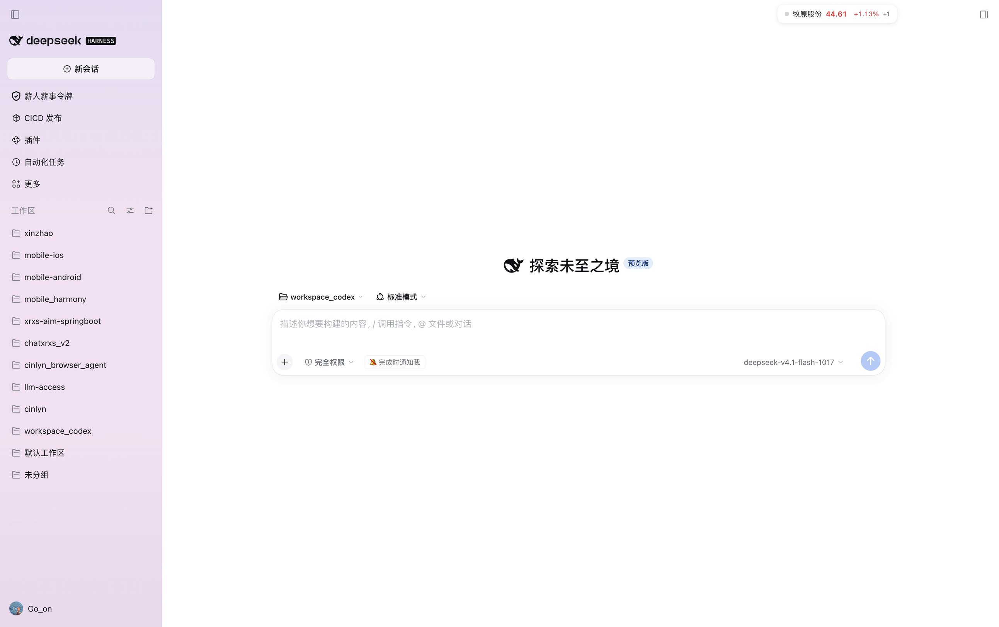
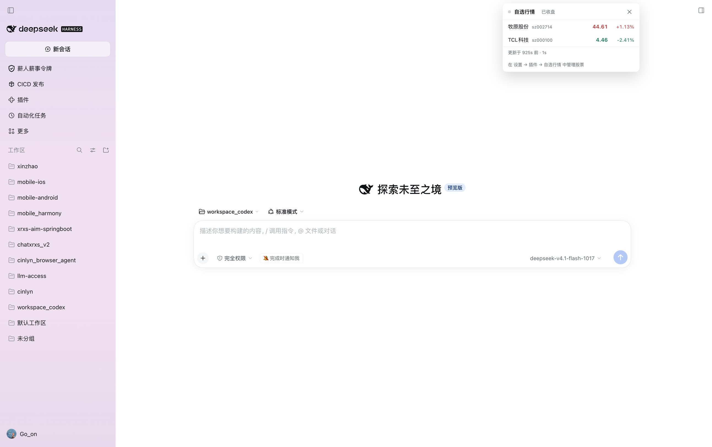
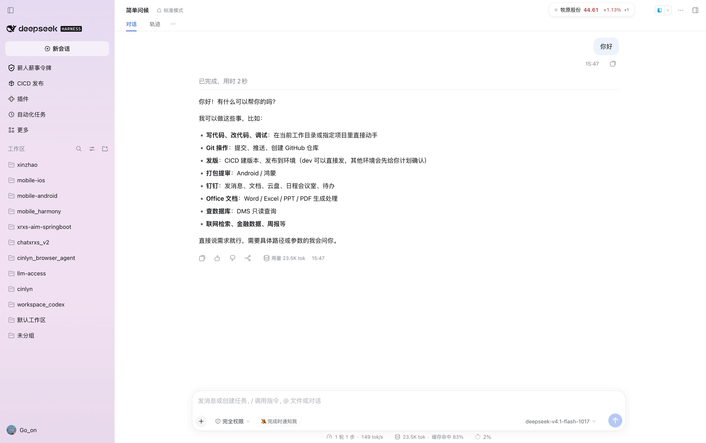

# DSH Stock Ticker

在 DSH 桌面端右上角常驻显示 A 股自选行情的插件：红涨绿跌、盘中按秒刷新、深浅色自适应。

> 收起时是一枚胶囊（股票名 + 现价 + 涨跌幅），点开是完整自选列表。

## 界面

<table>
  <tr>
    <td width="50%"></td>
    <td width="50%"></td>
  </tr>
  <tr>
    <td align="center"><sub>收起态：一枚胶囊，股票名 + 现价 + 涨跌幅</sub></td>
    <td align="center"><sub>展开：完整自选，并标注「已收盘」等交易阶段</sub></td>
  </tr>
</table>

对话页里也一直挂着，不抢输入框的位置：



## 功能

- **常驻悬浮胶囊**：挂在 `shell.overlay`，任何页面都看得见，可折叠；位置与间距与 DSH 头部按钮行对齐。
- **展开面板**：点击胶囊展开完整列表，显示名称、代码、现价、涨跌幅，并标注当前交易阶段（盘前 / 盘中 / 午休 / 收盘 / 休市）。
- **设置页**：`设置 → 插件 → 自选行情` 里管理股票列表、刷新间隔、总开关，保存即热生效并持久化（重启不丢）。
- **对话内管理**：直接跟 Agent 说「帮我加一只茅台」「刷新改成 5 秒」，会调用 `stock_ticker_manage` 工具。
- **红涨绿跌**：A 股配色，深色主题下自动换成更亮的红绿。
- **交易时段感知**：Asia/Shanghai 周一至周五 09:30–11:30、13:00–15:00 视为盘中轮询；午休、盘前、收盘只取一次快照。
- **节假日自检**：开盘窗口内发现行情时间戳仍是上一交易日，即判定节假日休市——悬浮条标注「休市（节假日）」，轮询自动降频为 60 秒一次的探测，下一个交易日开盘数据变新即恢复全速（无需维护节假日表，临时休市也自动覆盖）。
- **毛玻璃外观**：半透明白 / 深灰两套玻璃质感，跟随 DSH 主题（`body[data-ds-dark-theme]`）切换。

## 安装

插件以 DSH profile 的 bundle 方式加载。

```bash
# 1. 拿到代码
git clone https://github.com/AngChow/stock-ticker-plugin.git

# 2. 链接进你的 DSH profile（示例为 desktop）
cd ~/.dsh/profiles/desktop
pnpm add link:/绝对路径/stock-ticker-plugin

# 3. 在 profile 的 package.json 里把插件加入 bundles
#    dsh.profile.bundles 末尾追加 "stock-ticker"
```

也可以直接在 DSH 的「插件」页面安装，或使用 `plugin_manager` 工具：

```
plugin_manager(action=install_bundle, target=link:/绝对路径/stock-ticker-plugin)
```

装好后重启 DSH，右上角出现行情胶囊即成功。

## 配置

`cordis.patch.yml` 里的 `config` 作为首次安装的初始值：

```yaml
- insert:
    - id: stock-ticker
      name: 'stock-ticker'
      config:
        symbols: [sh600519, sh601688, sz300750]
        pollSeconds: 2      # 1–120
        enabled: true
```

此后以设置页存储的值为准（storageDomain 持久化），patch 层只在首次初始化时生效。

股票代码支持多种写法：`600519`、`sh600519`、`00700`、`AAPL`，添加时会自动规范化为腾讯接口格式。

## 数据源

| 场景 | 数据源 | 说明 |
| --- | --- | --- |
| 盘中行情 | 腾讯免费行情 `qt.gtimg.cn` | 毫秒级批量接口，默认 2 秒一轮（1–120 秒可配） |
| 添加 / 校验代码 | 腾讯（主）／ 涨乐财富通（兜底，可选） | 腾讯直接返回代码对应名称，秒级；仅当腾讯查不到或不可达时才回落到涨乐（5–14 秒，需 `HT_APIKEY`） |

涨乐接口延迟较高，因此**不做盘中轮询**；秒级行情全部走腾讯的结构化接口。新增股票同样腾讯优先，涨乐只在腾讯查无此代码时兜底——没配 `HT_APIKEY` 的同事不受影响，只是那类边界代码（如部分北交所标的）会添加失败。

`HT_APIKEY`（**可选**）从 `~/.htsc-skills/config` 读取，仅驻留内存，不落盘、不打印；读不到时自动跳过涨乐兜底，不做任何提示阻塞。

## 开发

```bash
# 单元测试（引擎 + Client 冒烟，共 23 项）
node --test tests/

# 语法检查
node --check index.js && node --check client.js
```

> 本插件是纯 JS，没有编译步骤：`lib/` 就是源码而不是构建产物，`prepack` 只跑一次语法校验，因此 `npm pack` 出来的包始终与工作区一致。

### 结构

```
index.js            Host 半区：行情引擎、/api/stock-ticker RPC、stock_ticker_manage 工具
client.js           Client 半区：shell.overlay 悬浮条 + settings.plugins.tab 设置页
lib/
  market-hours.js   交易时段判定（Asia/Shanghai，零副作用）
  normalize.js      股票代码规范化
  quotes-tencent.js 腾讯行情抓取与 GBK 解码
  zhangle.js        涨乐 queryIndicator 校验
locale/             中英文文案
tests/              引擎单测 + Client 冒烟（node --test）
```

### 踩坑备忘

- **Client 半区必须声明 `inject: ['slots', 'locale']`**。Client 侧 Cordis 与 Host 一样有 inject 门控，未声明就访问 `ctx.slots` 会抛 `cannot get property "slots" without inject`，导致 client entry 变 failed、宿主 renderer 启动检查失败（整个 App 起不来）。
- **主题切换用 `body[data-ds-dark-theme]`，不要用 `@media (prefers-color-scheme: dark)`**。DSH 的主题是应用内设置，未必与系统外观一致。

### 已知限制

- 节假日/临时休市由行情时间戳自检识别（见「节假日自检」）：判定生效前的首次拉取仍是一次全速请求，之后降频探测期约 60s 一请求。
- 北交所 / 美股代码为尽力而为，以腾讯接口覆盖范围为准。

## License

MIT